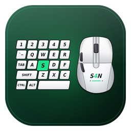

<div align="center">



# S4N Macro

**Utilitas input untuk Windows: hold klik kanan, macro mouse & keyboard, overlay stream, dan tweak kontrol dalam satu aplikasi ringan.**

<br />

[](https://github.com/ihsanamiruddinn/S4N_MacroKey/releases/latest/download/S4N-Macro-win-x64.zip)

[](https://github.com/ihsanamiruddinn/S4N_MacroKey/releases/latest)
[](https://github.com/ihsanamiruddinn/S4N_MacroKey/releases)
-2d3b35?style=flat-square)

</div>

---

<!--
  SCREENSHOT: tambahkan gambar ke folder assets/screenshots/ lalu hapus tanda komentar di bawah ini.

<div align="center">
  
  
</div>
-->

## Fitur

| | |
|---|---|
| **Right Click Hold** | Tahan klik kanan dengan satu hotkey (toggle). Hanya aktif saat aplikasi target berada di depan. Tersedia hotkey darurat untuk melepas seketika. |
| **Anti-AFK** | Mengirim klik kiri ke aplikasi target di latar belakang setiap 30 detik, tanpa perlu membuka jendelanya. |
| **Macro Mouse** | Ubah output tombol mouse, Position Click (single / hold / spam), Spam Click, Drag, Anti Recoil, dan pemutar macro dengan kontrol Play / Pause / Stop. |
| **Macro Keyboard** | Aturan *Input → Output* untuk memetakan ulang tombol. Hanya berlaku saat aplikasi target aktif. |
| **Overlay Stream** | Tampilan keyboard, mouse, ping, dan teks ketikan di layar. Bisa *click-through*, dan bisa disembunyikan dari tampilan game tetapi tetap tertangkap OBS lewat *Window Capture*. |
| **Tweak** | *SOCD Cleaner* (input arah terakhir yang menang), *Camera / Mouse Flick* dengan jarak X/Y dan arah bergantian, serta *Reduce Lag* (prioritas proses tinggi). |
| **Notifikasi Toast** | Pop-up status hold dengan 8 pilihan posisi dan durasi yang bisa diatur. |
| **Praktis** | Berjalan di system tray, opsi *Start with Windows*, dan tidak memerlukan hak Administrator. |

## Persyaratan

- Windows 10 atau Windows 11, 64-bit
- Tidak perlu memasang .NET atau komponen tambahan (sudah termasuk dalam paket)

## Instalasi

1. Klik tombol **Download untuk Windows** di atas (file `S4N-Macro-win-x64.zip`).
2. Ekstrak zip ke folder permanen, misalnya `C:\Program Files\S4N Macro` atau `D:\Apps\S4N Macro`. Jangan dijalankan langsung dari dalam zip.
3. Jalankan `S4N Macro.exe`.

> **Muncul peringatan "Windows protected your PC"?**
> Aplikasi ini belum memiliki tanda tangan digital, jadi Windows SmartScreen menampilkan peringatan untuk aplikasi baru. Klik **More info → Run anyway**.
> Untuk memastikan file tidak berubah, bandingkan hash-nya dengan yang tercantum di halaman [Releases](https://github.com/ihsanamiruddinn/S4N_MacroKey/releases):
> ```powershell
> Get-FileHash .\S4N-Macro-win-x64.zip -Algorithm SHA256
> ```

## Panduan Penggunaan

### Mulai cepat (3 langkah)

1. **Pilih aplikasi target.** Jalankan game atau aplikasi Anda terlebih dahulu. Di S4N Macro buka menu **Applications**, pilih aplikasinya dari daftar (gunakan **Refresh** jika belum muncul), lalu klik **Use this application**.
2. **Atur hotkey hold.** Di **Dashboard**, klik kotak **Toggle Hotkey** lalu tekan tombol atau kombinasi yang Anda inginkan.
3. **Pakai.** Saat aplikasi target aktif, tekan hotkey untuk menahan klik kanan, tekan lagi untuk melepas. Tombol darurat bawaan adalah **F12** (atau klik **Emergency Release**).

Menutup jendela akan menyembunyikan S4N Macro ke system tray. Untuk membuka kembali, klik ikonnya lalu pilih **Open S4N Macro**. Untuk keluar sepenuhnya, pilih **Exit**.

### Dashboard

Menampilkan aplikasi target, status hold (*Held* / *Released*), hotkey toggle, dan tombol **Emergency Release**. Di sini juga ada **Anti-AFK**: aktifkan untuk mengirim klik kiri ke aplikasi target setiap 30 detik di latar belakang.

### Macro → Mouse

Pilih tombol mouse (Left, Right, Middle, Forward, Backward), lalu atur:

- **Change Output**: ubah tombol tersebut menjadi tombol lain (klik **Rec** untuk merekam).
- **Macro Click / Position Click**: pilih mode *Single Click*, *Hold*, atau *Spam*, atur hitung mundur sebelum klik, kecepatan, dan durasi (0 = tanpa batas). Buka **Player** untuk menjalankannya dengan **F1 Play · F2 Pause · F3 Stop**.
- **Spam Click**, **Drag**, **Anti Recoil**: atur tombol pemicu dan kecepatan atau kekuatannya.

Klik **Simpan Pengaturan** untuk menerapkan.

### Macro → Keyboard

Klik **+ Create** untuk membuat aturan, pilih tombol *Input* dan tombol *Output*, lalu **Simpan Perubahan**. Aturan hanya aktif saat aplikasi target berada di depan.

### Overlay

Aktifkan **Enable Overlay**, lalu pilih komponen yang ingin ditampilkan: keyboard (tata letak kiri atau penuh), mouse, ping, dan teks ketikan.

- **Lock Position (Click-Through)**: klik mouse menembus overlay. Matikan untuk menggeser posisinya.
- **Show Overlay in Game**: jika dimatikan, overlay tidak terlihat di layar Anda tetapi tetap bisa ditangkap OBS lewat *Window Capture*.

### Tweak

- **SOCD Cleaner**: bila dua arah berlawanan (A+D atau W+S) ditekan bersamaan, arah yang ditekan terakhir yang dipakai.
- **Camera / Mouse Flick**: menggeser kursor sejauh nilai X (kanan +, kiri −) dan Y (bawah +, atas −) saat hotkey ditekan. Aktifkan **Alternate Direction** untuk arah kanan-kiri bergantian.
- **Reduce Lag**: menaikkan prioritas proses S4N Macro di Windows.

### Settings

Atur **Start with Windows** serta notifikasi toast (aktif/nonaktif, posisi, dan durasi).

## Tanya Jawab

**Hotkey tidak bekerja di game saya.**
Pastikan aplikasi target sudah dipilih di menu *Applications* dan sedang berada di depan. Jika game dijalankan sebagai Administrator, jalankan juga S4N Macro sebagai Administrator (klik kanan `S4N Macro.exe` → *Run as administrator*), karena Windows tidak mengizinkan aplikasi biasa membaca input ke aplikasi yang berhak lebih tinggi.

**Windows Defender atau antivirus menandai file ini.**
Aplikasi yang membaca tombol global dan mensimulasikan input kadang diberi peringatan oleh antivirus, terutama yang belum bertanda tangan digital. Pastikan Anda mengunduh hanya dari halaman Releases resmi ini dan cocokkan hash-nya.

**Di mana pengaturan disimpan?**
Secara lokal di `%LOCALAPPDATA%\SmartMouseHold\` (`config.json` dan `app.log`). Menghapus folder itu mengembalikan semua pengaturan ke bawaan.

**Bagaimana cara menghapus aplikasi?**
Matikan *Start with Windows* di Settings, pilih **Exit** dari ikon tray, lalu hapus folder aplikasi. Opsional: hapus folder pengaturan di atas.

**Aplikasi macet atau ada yang tidak beres.**
Buka [Issues](https://github.com/ihsanamiruddinn/S4N_MacroKey/issues) dan sertakan versi aplikasi, versi Windows, langkah untuk mengulang masalahnya, serta isi `app.log` bila ada.

## Privasi

- S4N Macro **tidak mengirim penekanan tombol, pengaturan, atau data pribadi** ke mana pun.
- Aplikasi membaca input tombol dan mouse secara global hanya untuk menjalankan hotkey, macro, dan overlay. Input tidak disimpan.
- Satu-satunya aktivitas jaringan adalah **ping ICMP ke `1.1.1.1`** (Cloudflare) untuk menampilkan angka *Ping* di overlay.

## Penafian

Perangkat lunak ini disediakan **apa adanya, tanpa jaminan apa pun**. Sebagian game dan layanan online melarang macro, otomatisasi input, atau pembacaan input oleh program lain, dan sistem anti-cheat tertentu dapat mendeteksinya. **Pemakaian sepenuhnya menjadi tanggung jawab Anda**, termasuk risiko pembatasan atau pemblokiran akun. Periksa aturan layanan sebelum memakainya, dan jangan gunakan untuk berbuat curang di permainan kompetitif.

## Lisensi

Hak cipta © 2026 ihsanamiruddinn. Gratis untuk penggunaan pribadi, tidak boleh didistribusikan ulang atau dimodifikasi. Selengkapnya di [LICENSE](LICENSE).
